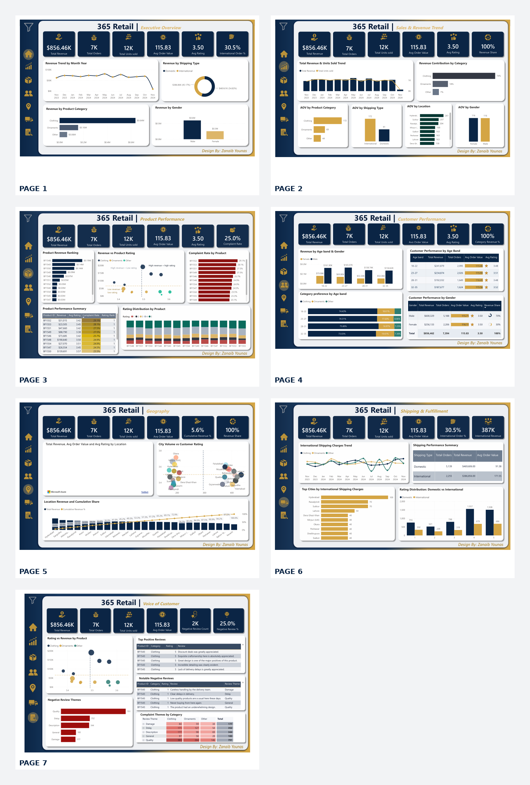

# 365 Retail Sales Dashboard | Power BI

## Project Overview

The 365 Retail Sales Dashboard is a seven-page business intelligence project developed using Microsoft Power BI Desktop.

The project analyzes retail sales, revenue trends, product performance, customer behavior, geographical performance, shipping operations, and customer feedback.

It provides a comprehensive overview of retail business performance through KPIs, charts, and detailed analytical reports.

## Tools & Technologies
- Microsoft Power BI Desktop
- Data Analysis
- Data Visualization
- Business Intelligence
- KPI Reporting

## Dashboard Pages

1. **Executive Overview** – Overall business performance, revenue, orders, shipping type, product category, and gender analysis.
2. **Sales & Revenue Trend** – Monthly revenue trends, units sold, category contribution, and average order value.
3. **Product Performance** – Product revenue ranking, ratings, complaint rates, and product-level performance.
4. **Customer Performance** – Customer segmentation by age band and gender, revenue, orders, and category preferences.
5. **Geography** – Location-based revenue, average order value, customer ratings, and cumulative revenue contribution.
6. **Shipping & Fulfillment** – Domestic and international shipping performance, shipping charges, and rating distribution.
7. **Voice of Customer** – Positive and negative customer reviews, complaint themes, and category-wise feedback.

## Key Performance Indicators

| KPI | Result |
|---|---:|
| Total Revenue | $856.46K |
| Total Orders | 7,394 |
| Total Units Sold | 12K |
| Average Order Value | 115.83 |
| Average Rating | 3.50 |
| International Order % | 30.5% |

## Key Business Insights

- Clothing contributes approximately 74% of total revenue.
- Male customers account for approximately 70% of total revenue.
- International orders contribute 30.5% of total orders.
- Quality is the largest negative review theme, with 791 reviews.
- International shipping generates approximately $386.86K in revenue.

## Dashboard Design

**Color Palette:**
- Navy Blue: `#0B2545`
- Gold: `#D4A544`
- Light Background: `#F7F8FA`

## Dashboard Preview

## Project Files

- `365_Retail_Dashboard.pbix` – Power BI project file.
- `365_Retail_Dashboard.pdf` – Seven-page PDF report.
- `365_Retail_Dashboard_Preview.png` – Dashboard preview.

## Author

**Zanaib Younas**

Aspiring Data Analyst | Power BI | Excel | SQL

[LinkedIn](https://www.linkedin.com/in/zanaibyounas/)

[GitHub](https://github.com/zanaib2908)

---

*Designed and developed by Zanaib Younas.*
